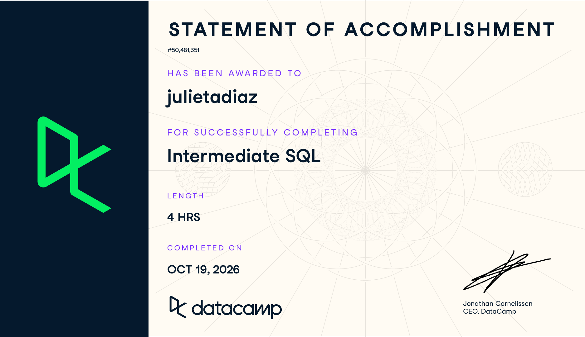

**Assignment:** SQL3: Intermediate SQL (DataCamp)\
**Course:** IBM 6500, Customer Insight Methods and Survey Research\
**Instructor:** Dr. Jae Jung\
**Program:** MSDM, Cal Poly Pomona

# Course-Completion Evidence

I completed the **Intermediate SQL** course through the IBM 6500 DataCamp classroom on **October 19, 2026**. DataCamp issued the Statement of Accomplishment below, which shows my name and the course title.

{fig-alt="DataCamp Statement of Accomplishment for the Intermediate SQL course, awarded to julietadiaz, completed October 19, 2026." width="92%" fig-align="center"}

# Learning Notes and Key Takeaways

The course is organized into four chapters: **Selecting Data**, **Filtering Records**, **Aggregate Functions**, and **Sorting and Grouping**. Together they move from pulling columns out of a table to answering real business questions with filters, summaries, and groups.

Every exercise uses a film database with four tables. I use the same tables in my examples below so the notes stay consistent and every query could be rerun as written:

```{=html}
<div class="schema-grid" style="grid-template-columns: repeat(auto-fit, minmax(300px, 1fr));">
  <div class="schema-table">
    <div class="schema-name">films</div>
    <div class="schema-row key"><span>id</span><span>INT</span></div>
    <div class="schema-row"><span>title</span><span>VARCHAR</span></div>
    <div class="schema-row"><span>release_year</span><span>INT</span></div>
    <div class="schema-row"><span>country</span><span>VARCHAR</span></div>
    <div class="schema-row"><span>duration</span><span>INT</span></div>
    <div class="schema-row"><span>language</span><span>VARCHAR</span></div>
    <div class="schema-row"><span>certification</span><span>VARCHAR</span></div>
    <div class="schema-row"><span>gross</span><span>INT</span></div>
    <div class="schema-row"><span>budget</span><span>INT</span></div>
  </div>
  <div class="schema-table">
    <div class="schema-name">reviews</div>
    <div class="schema-row key"><span>id</span><span>INT</span></div>
    <div class="schema-row"><span>film_id</span><span>INT</span></div>
    <div class="schema-row"><span>num_user</span><span>INT</span></div>
    <div class="schema-row"><span>num_critic</span><span>INT</span></div>
    <div class="schema-row"><span>imdb_score</span><span>FLOAT</span></div>
    <div class="schema-row"><span>num_votes</span><span>INT</span></div>
    <div class="schema-row"><span>facebook_likes</span><span>INT</span></div>
  </div>
  <div class="schema-table">
    <div class="schema-name">people</div>
    <div class="schema-row key"><span>id</span><span>INT</span></div>
    <div class="schema-row"><span>name</span><span>VARCHAR</span></div>
    <div class="schema-row"><span>birthdate</span><span>DATE</span></div>
    <div class="schema-row"><span>deathdate</span><span>DATE</span></div>
  </div>
  <div class="schema-table">
    <div class="schema-name">roles</div>
    <div class="schema-row key"><span>id</span><span>INT</span></div>
    <div class="schema-row"><span>film_id</span><span>INT</span></div>
    <div class="schema-row"><span>person_id</span><span>INT</span></div>
    <div class="schema-row"><span>role</span><span>VARCHAR</span></div>
  </div>
</div>
```

::: {.schema-caption}
Film database used throughout the course. `reviews` and `roles` link to `films` through `film_id`, and `roles` links to `people` through `person_id`.
:::

## Chapter 1: Selecting Data

### Counting Records with COUNT()

#### Main ideas {.unnumbered .unlisted}

- `COUNT()` is an **aggregate function**: it looks at many rows and returns one number.
- `COUNT(*)` counts **every row** in the table, including rows with missing values.
- `COUNT(field_name)` counts only the rows where that field is **not missing** (not `NULL`). That is why `COUNT(birthdate)` can be smaller than `COUNT(*)` on the `people` table.
- Several counts can go in one `SELECT`, separated by commas, each with its own alias.
- `COUNT(DISTINCT field)` counts how many **different** values a field has, ignoring repeats.

#### Important SQL syntax {.unnumbered .unlisted}

| Syntax | What it returns |
|:-------|:----------------|
| `COUNT(*)` | Total number of rows |
| `COUNT(field)` | Number of non-missing values in that field |
| `COUNT(DISTINCT field)` | Number of unique non-missing values |
| `SELECT DISTINCT field` | The list of unique values (not a count) |
| `AS alias` | Gives the result column a readable name |

#### When to use it {.unnumbered .unlisted}

Use counts to learn the size of a table and how complete each field is before analyzing it. `DISTINCT` answers "what are the possible values?" and `COUNT(DISTINCT ...)` answers "how many possible values are there?"

#### SQL example {.unnumbered .unlisted}

```sql
-- Size of the table, completeness of a field, and number of unique countries
SELECT
    COUNT(*) AS count_records,
    COUNT(birthdate) AS count_birthdate
FROM people;

SELECT COUNT(DISTINCT country) AS count_distinct_countries
FROM films;
```

#### Explanation {.unnumbered .unlisted}

The first query returns one row with two numbers: how many people are in the table and how many of them have a recorded birthdate. The gap between the two shows how many birthdates are missing. The second query returns one number: how many different countries produced films in the dataset, counting each country once no matter how many films it has.

::: {.callout-tip title="CEP application"}
Before analyzing a client's customer list, I would compare `COUNT(*)` with `COUNT(email)` or `COUNT(zip_code)` to see how much contact data is missing. `COUNT(DISTINCT customer_id)` on an orders table gives the number of unique customers, which is different from the number of orders and is a core marketing metric.
:::

### Query Execution Order

#### Main ideas {.unnumbered .unlisted}

- SQL is not run in the order it is written. The database first reads `FROM` (where the data comes from), then `SELECT` (which columns), then `LIMIT` (how many rows to show).
- Later chapters add more clauses. The full order I need to remember is: `FROM`, `WHERE`, `GROUP BY`, `HAVING`, `SELECT`, `ORDER BY`, `LIMIT`.
- Because `SELECT` runs after `WHERE`, an alias created in `SELECT` **cannot** be used in `WHERE`. Because `ORDER BY` runs after `SELECT`, an alias **can** be used in `ORDER BY`.

#### Important SQL syntax {.unnumbered .unlisted}

| Written order | Execution order |
|:--------------|:----------------|
| `SELECT` | 1. `FROM` |
| `FROM` | 2. `WHERE` |
| `WHERE` | 3. `GROUP BY` |
| `GROUP BY` | 4. `HAVING` |
| `HAVING` | 5. `SELECT` |
| `ORDER BY` | 6. `ORDER BY` |
| `LIMIT` | 7. `LIMIT` |

#### When to use it {.unnumbered .unlisted}

Knowing the order explains many errors, especially "column does not exist" errors caused by using an alias in the wrong clause.

#### SQL example {.unnumbered .unlisted}

```sql
-- The alias works in ORDER BY because ORDER BY runs after SELECT
SELECT title, duration / 60.0 AS duration_hours
FROM films
ORDER BY duration_hours DESC
LIMIT 5;
```

#### Explanation {.unnumbered .unlisted}

The database reads `films`, calculates each film's length in hours, sorts from longest to shortest, and then keeps the top five rows. If I tried `WHERE duration_hours > 2`, it would fail, because `WHERE` runs before the alias exists. I would need `WHERE duration > 120` instead.

::: {.callout-tip title="CEP application"}
When a campaign query errors out, checking execution order is my first troubleshooting step. It saves time when writing longer queries for a client report under a deadline.
:::

### Debugging Errors

#### Main ideas {.unnumbered .unlisted}

- Most beginner errors are small: a **misspelled keyword or table name** (`COUNNT`, `peeple`), a **misspelled field name** (`certfication`), or **missing commas** between fields in `SELECT`.
- The error message usually points near the problem (for example, "syntax error at or near" a word, or "column does not exist").
- Reading the error carefully and checking spelling against the schema fixes most problems.

#### Important SQL syntax {.unnumbered .unlisted}

| Error type | Broken | Fixed |
|:-----------|:-------|:------|
| Misspelled field | `SELECT certfication` | `SELECT certification` |
| Missing commas | `SELECT film_id imdb_score num_votes` | `SELECT film_id, imdb_score, num_votes` |
| Misspelled function | `COUNNT(birthdate)` | `COUNT(birthdate)` |
| Misspelled table | `FROM peeple` | `FROM people` |

#### When to use it {.unnumbered .unlisted}

Any time a query fails. Checking spelling, commas, and parentheses first is faster than rewriting the whole query.

#### SQL example {.unnumbered .unlisted}

```sql
-- Corrected version of the course's buggy query
SELECT COUNT(birthdate) AS count_birthdays
FROM people;
```

#### Explanation {.unnumbered .unlisted}

The original query had two typos, `COUNNT` and `peeple`. After fixing them, the query returns how many people in the table have a recorded birthdate, under the column name `count_birthdays`.

::: {.callout-tip title="CEP application"}
Client datasets often have long or inconsistent column names. Copying names directly from the schema instead of typing them prevents most typos.
:::

### SQL Style and Formatting

#### Main ideas {.unnumbered .unlisted}

- SQL runs the same no matter how it is formatted, but readable code is easier for teammates (and my future self) to check.
- The course follows **Holywell's SQL style guide**:
  - Write keywords in **UPPERCASE** (`SELECT`, `FROM`).
  - Put each main clause on its own line.
  - Use **underscores** instead of spaces in field names.
  - End every query with a **semicolon**, which is required when running several queries together.
- If a field name has spaces or other non-standard characters (for example `facebook likes`), wrap it in **double quotes**: `"facebook likes"`. The better long-term fix is to rename the field.

#### Important SQL syntax {.unnumbered .unlisted}

| Best practice | Poor practice |
|:--------------|:--------------|
| Capitalize keywords | Lowercase keywords |
| One clause per line | Whole query on one line |
| End queries with `;` | Many queries with no semicolons |
| `field_name` with underscores | `field name` with spaces |

#### When to use it {.unnumbered .unlisted}

Always, and especially for queries that will be shared, graded, or reused in a group project.

#### SQL example {.unnumbered .unlisted}

```sql
-- Before: select person_id, role from roles limit 10
SELECT person_id, role
FROM roles
LIMIT 10;

-- A field name that contains a space needs double quotes
SELECT film_id, "facebook likes"
FROM reviews;
```

#### Explanation {.unnumbered .unlisted}

The first query is the course's poorly formatted query rewritten with uppercase keywords, separate lines, and a semicolon. It returns the first ten person and role pairs. The second shows how to select a column whose name contains a space; without the quotes, SQL would read `facebook` and `likes` as two separate things and fail.

::: {.callout-tip title="CEP application"}
Exports from ad platforms and survey tools often have column names like `Campaign Name` or `Q3 Satisfaction`. I would either rename them with underscores when loading the data or quote them in my queries, and I would format every query consistently so my CEP team can review each other's work.
:::

## Chapter 2: Filtering Records

### Filtering Numbers and Text with WHERE

#### Main ideas {.unnumbered .unlisted}

- `WHERE` keeps only the rows that meet a condition. It goes after `FROM`.
- **Comparison operators** work on numbers: `>` greater than, `<` less than, `>=` at least, `<=` at most, `=` equal, `<>` not equal.
- Text values go in **single quotes**: `WHERE language = 'Spanish'`.
- `WHERE` can be combined with aggregate functions such as `COUNT()` to count only matching rows.

#### Important SQL syntax {.unnumbered .unlisted}

| Syntax | Keeps rows where... |
|:-------|:--------------------|
| `WHERE imdb_score > 7.0` | Score is above 7.0 |
| `WHERE facebook_likes < 1000` | Fewer than 1,000 likes |
| `WHERE num_votes >= 100000` | At least 100,000 votes |
| `WHERE language = 'Spanish'` | Language is exactly Spanish |
| `WHERE country <> 'USA'` | Country is anything except USA |

#### When to use it {.unnumbered .unlisted}

Whenever only part of a table matters, such as one year, one category, or values above a threshold.

#### SQL example {.unnumbered .unlisted}

```sql
-- How many films have at least 100,000 votes?
SELECT COUNT(num_votes) AS films_over_100K_votes
FROM reviews
WHERE num_votes >= 100000;

-- How many films are in Spanish?
SELECT COUNT(language) AS count_spanish
FROM films
WHERE language = 'Spanish';
```

#### Explanation {.unnumbered .unlisted}

In each query, `WHERE` removes the rows that do not match before `COUNT()` runs. The first returns the number of widely reviewed films, and the second returns the number of Spanish-language films. Note that numbers have no quotes and text does.

::: {.callout-tip title="CEP application"}
`WHERE` is how I would isolate one segment: orders over $100, survey respondents from one region, or website sessions from one traffic source such as `'Instagram'`.
:::

### Multiple Criteria: AND, OR, and BETWEEN

#### Main ideas {.unnumbered .unlisted}

- `AND` requires **every** condition to be true. `OR` requires **at least one** to be true.
- When mixing `AND` and `OR`, wrap the `OR` conditions in **parentheses** so SQL evaluates them together. Without parentheses the results can be wrong.
- `BETWEEN low AND high` keeps values in a range and is **inclusive**: both end values are included.
- A field must be repeated for each `OR` condition: `release_year = 1990 OR release_year = 1999`, not `release_year = 1990 OR 1999`.

#### Important SQL syntax {.unnumbered .unlisted}

| Syntax | Meaning |
|:-------|:--------|
| `WHERE a AND b` | Both must be true |
| `WHERE a OR b` | Either can be true |
| `WHERE (a OR b) AND c` | One of a or b, plus c |
| `WHERE release_year BETWEEN 1990 AND 2000` | 1990 through 2000, inclusive |

#### When to use it {.unnumbered .unlisted}

When a question has more than one requirement, such as a date range plus a category plus a minimum value.

#### SQL example {.unnumbered .unlisted}

```sql
-- Spanish or French films from 1990 to 2000 with budgets over $100 million
SELECT title, release_year
FROM films
WHERE release_year BETWEEN 1990 AND 2000
    AND budget > 100000000
    AND (language = 'Spanish' OR language = 'French');
```

#### Explanation {.unnumbered .unlisted}

A film is returned only if all three lines are true: it was released from 1990 through 2000, its budget was over $100 million, and its language was Spanish or French. The parentheses make sure the `OR` is checked as one condition. Without them, SQL would return every French film regardless of year or budget.

::: {.callout-tip title="CEP application"}
Campaign questions almost always combine conditions, for example "purchases during the holiday promotion (`BETWEEN` two dates) from email or social traffic (`OR`) with an order value over $50 (`AND`)." Remembering the parentheses prevents an inflated result.
:::

### Pattern Matching and Lists: LIKE, NOT LIKE, and IN

#### Main ideas {.unnumbered .unlisted}

- `LIKE` searches text for a **pattern** instead of an exact match. `NOT LIKE` returns the rows that do not match.
- Two **wildcards** build patterns:
  - `%` matches **zero or more** characters. `'B%'` means "starts with B."
  - `_` matches **exactly one** character. `'_r%'` means "second letter is r."
- `IN (value1, value2, ...)` checks whether a value is in a list. It replaces a long chain of `OR` conditions and works with numbers or text.

#### Important SQL syntax {.unnumbered .unlisted}

| Syntax | Matches |
|:-------|:--------|
| `LIKE 'B%'` | Starts with B |
| `LIKE '%son'` | Ends with "son" |
| `LIKE '_r%'` | Second letter is r |
| `NOT LIKE 'A%'` | Does not start with A |
| `IN (1990, 2000)` | Either year |
| `IN ('English', 'Spanish', 'French')` | Any of the three languages |

#### When to use it {.unnumbered .unlisted}

`LIKE` is for partial text matches, such as names, product titles, URLs, or campaign codes. `IN` is for checking against a short list of allowed values.

#### SQL example {.unnumbered .unlisted}

```sql
-- Names whose second letter is r
SELECT name
FROM people
WHERE name LIKE '_r%';

-- English, Italian, or Greek films rated NC-17 or R
SELECT title, certification, language
FROM films
WHERE certification IN ('NC-17', 'R')
    AND language IN ('English', 'Italian', 'Greek');
```

#### Explanation {.unnumbered .unlisted}

The first query returns names such as "Brad" or "Ariana" whose second character is `r`, since `_` holds exactly one letter before it and `%` allows anything after. The second query returns adult-rated films in three languages. Each `IN` list does the work of several `OR` conditions, which keeps the query short.

::: {.callout-tip title="CEP application"}
`LIKE '%utm_source=instagram%'` could find website visits from Instagram links, and `LIKE '%vintage%'` could find product titles containing a keyword. `IN` is ideal for a list of target states, product categories, or campaign IDs.
:::

### Combining Filters and Selecting

#### Main ideas {.unnumbered .unlisted}

- Real questions combine everything from this chapter: `COUNT(DISTINCT ...)`, `BETWEEN`, `AND`, and `IN` in one query.
- `DISTINCT` inside `COUNT()` matters when names repeat. The course dataset contains two films titled "Hamlet," so counting titles without `DISTINCT` would count it twice.
- Building a long query **one filter at a time**, and running it after each step, makes errors easy to find.

#### Important SQL syntax {.unnumbered .unlisted}

```sql
SELECT COUNT(DISTINCT field) AS alias
FROM table
WHERE condition_1
    AND condition_2
    AND field IN (...);
```

#### When to use it {.unnumbered .unlisted}

When the final answer is a single number that depends on several requirements at once.

#### SQL example {.unnumbered .unlisted}

```sql
-- 1990s English-language films suitable for teens
SELECT COUNT(DISTINCT title) AS nineties_english_films_for_teens
FROM films
WHERE release_year BETWEEN 1990 AND 1999
    AND language = 'English'
    AND certification IN ('G', 'PG', 'PG-13');
```

#### Explanation {.unnumbered .unlisted}

The query keeps only English films released from 1990 through 1999 with a family or teen rating, then counts the unique titles. The result is one number answering the business question in the exercise: how many 90s films in the dataset would suit English-speaking teens.

::: {.callout-tip title="CEP application"}
This is the shape of a typical audience-sizing question: "How many unique customers aged 18 to 34 in California bought from the beauty or fashion category?" Each requirement becomes one line of the `WHERE` clause.
:::

### Missing Values: NULL

#### Main ideas {.unnumbered .unlisted}

- `NULL` means a value is **missing or unknown**. It is not zero and not an empty string.
- `NULL` cannot be found with `=`. I must use `IS NULL` to find missing values and `IS NOT NULL` to find recorded values.
- `COUNT(field)` already skips `NULL`s, so `COUNT(field)` and `COUNT(*) ... WHERE field IS NOT NULL` give the same number.

#### Important SQL syntax {.unnumbered .unlisted}

| Syntax | Keeps rows where... |
|:-------|:--------------------|
| `WHERE budget IS NULL` | Budget is missing |
| `WHERE language IS NOT NULL` | Language is recorded |
| `WHERE budget = NULL` | Never works; returns no rows |

#### When to use it {.unnumbered .unlisted}

When checking data quality, or when a calculation should include only rows that actually have a value.

#### SQL example {.unnumbered .unlisted}

```sql
-- Films with no budget information
SELECT title AS no_budget_info
FROM films
WHERE budget IS NULL;

-- How many films have a known language?
SELECT COUNT(title) AS count_language_known
FROM films
WHERE language IS NOT NULL;
```

#### Explanation {.unnumbered .unlisted}

The first query lists every film whose budget is missing, under the heading `no_budget_info`. The second counts films that have a language recorded. Together they show how complete the `budget` and `language` fields are.

::: {.callout-tip title="CEP application"}
Survey data is full of `NULL`s from skipped questions. Before reporting an average satisfaction score, I would check how many respondents actually answered with `IS NOT NULL`, so I can report the true sample size.
:::

## Chapter 3: Aggregate Functions

### Summarizing Data: SUM, AVG, MIN, MAX, and COUNT

#### Main ideas {.unnumbered .unlisted}

- **Aggregate functions** summarize a whole column into one value:
  - `SUM()` adds values. `AVG()` finds the average.
  - `MIN()` finds the smallest value and `MAX()` the largest.
  - `COUNT()` counts values.
- `SUM()` and `AVG()` work **only on numbers**. `COUNT()`, `MIN()`, and `MAX()` work on **various data types**: for text, `MIN()` and `MAX()` return the first and last alphabetically, and for dates they return the earliest and latest.
- Aggregates ignore `NULL` values.
- Always alias aggregates (`AS total_duration`) so the output column has a clear name.

#### Important SQL syntax {.unnumbered .unlisted}

| Function | Numbers only? | Example result |
|:---------|:--------------|:---------------|
| `SUM(duration)` | Yes | Total minutes of all films |
| `AVG(duration)` | Yes | Average film length |
| `MIN(duration)` | No | Shortest film |
| `MAX(release_year)` | No | Most recent year |
| `COUNT(title)` | No | Number of titles |

#### When to use it {.unnumbered .unlisted}

For top-line numbers: totals, averages, and the highest or lowest values in a dataset.

#### SQL example {.unnumbered .unlisted}

```sql
SELECT
    SUM(duration) AS total_duration,
    AVG(duration) AS average_duration,
    MAX(release_year) AS latest_year,
    MIN(duration) AS shortest_film
FROM films;
```

#### Explanation {.unnumbered .unlisted}

The query returns a single row with four summary numbers for the whole `films` table: the total runtime of every film, the average runtime, the most recent release year, and the shortest film length. Each aggregate has its own alias, so the four columns are easy to tell apart.

::: {.callout-tip title="CEP application"}
These are the numbers at the top of any marketing dashboard: total revenue (`SUM`), average order value (`AVG`), largest order (`MAX`), and first purchase date (`MIN`).
:::

### Aggregates with WHERE

#### Main ideas {.unnumbered .unlisted}

- `WHERE` filters rows **before** the aggregate runs, so the summary describes only the matching rows.
- This combination answers questions about one segment, such as "total gross for films from 2000 onward."

#### Important SQL syntax {.unnumbered .unlisted}

```sql
SELECT AGGREGATE(field) AS alias
FROM table
WHERE condition;
```

#### When to use it {.unnumbered .unlisted}

When a summary is needed for a subset of the data rather than the whole table.

#### SQL example {.unnumbered .unlisted}

```sql
-- Average gross of films whose titles start with A
SELECT AVG(gross) AS avg_gross_A
FROM films
WHERE title LIKE 'A%';

-- Highest gross from 2000 through 2012
SELECT MAX(gross) AS highest_gross
FROM films
WHERE release_year BETWEEN 2000 AND 2012;
```

#### Explanation {.unnumbered .unlisted}

In the first query, only films with titles beginning with "A" are averaged. In the second, only films released from 2000 through 2012 are considered, and the single highest gross among them is returned. Any filter from Chapter 2 can be paired with any aggregate.

::: {.callout-tip title="CEP application"}
"Average order value for customers who came from the spring email campaign" is exactly this pattern: an `AVG()` with a `WHERE` on the traffic source and date range.
:::

### Rounding Results with ROUND()

#### Main ideas {.unnumbered .unlisted}

- `ROUND(number, decimal_places)` cleans up long decimals.
- A **positive** second argument keeps that many decimal places: `ROUND(x, 2)` gives cents.
- A second argument of **0** (or none) rounds to a whole number.
- A **negative** second argument rounds to the left of the decimal point: `-1` to the nearest ten, `-2` to the nearest hundred, `-3` to the nearest thousand.
- `ROUND()` can wrap an aggregate or a calculation: `ROUND(AVG(budget), -3)`.

#### Important SQL syntax {.unnumbered .unlisted}

| Syntax | Example: 1,234,567.891 becomes |
|:-------|:-------------------------------|
| `ROUND(x, 2)` | 1,234,567.89 |
| `ROUND(x, 0)` | 1,234,568 |
| `ROUND(x, -3)` | 1,235,000 |

#### When to use it {.unnumbered .unlisted}

For any number that will be shown to people, such as currency, percentages, and averages, so results are readable and appropriately precise.

#### SQL example {.unnumbered .unlisted}

```sql
-- Average Facebook likes to one decimal place
SELECT ROUND(AVG(facebook_likes), 1) AS avg_facebook_likes
FROM reviews;

-- Average budget rounded to the nearest thousand
SELECT ROUND(AVG(budget), -3) AS avg_budget_thousands
FROM films;
```

#### Explanation {.unnumbered .unlisted}

The first query averages likes across all reviews and keeps one decimal. The second averages film budgets and rounds to the nearest $1,000, which is precise enough for a budget benchmark and much easier to read than a long decimal.

::: {.callout-tip title="CEP application"}
I would round revenue to two decimals, conversion rates to one or two decimals, and large reach or impression numbers to the nearest thousand (`-3`) for executive-level slides.
:::

### Arithmetic and Aliasing

#### Main ideas {.unnumbered .unlisted}

- SQL can do math inside a query: `+`, `-`, `*`, and `/`.
- **Integer division** is a trap: dividing two whole numbers returns a whole number and drops the remainder. `2 / 10` returns **0**, not 0.2.
- To get a decimal answer, include a decimal number: `2 / 10.0` returns 0.2, and `duration / 60.0` converts minutes to hours correctly.
- Aliases are essential for calculated columns, since otherwise the result has an unclear name.
- Arithmetic combines with aggregates, such as `MAX(x) - MIN(x)` or `COUNT(a) * 100.0 / COUNT(*)` for a percentage.

#### Important SQL syntax {.unnumbered .unlisted}

| Expression | Result |
|:-----------|:-------|
| `4 + 3` | 7 |
| `2 / 10` | 0 (integer division) |
| `2 / 10.0` | 0.2 |
| `duration / 60.0 AS duration_hours` | Minutes converted to hours |
| `COUNT(deathdate) * 100.0 / COUNT(*)` | Percentage of rows with a value |

#### When to use it {.unnumbered .unlisted}

When the needed metric is not stored in the table but can be calculated from columns that are, such as a profit, a rate, or a unit conversion.

#### SQL example {.unnumbered .unlisted}

```sql
-- Film length in hours, rounded to two decimals
SELECT title, ROUND(duration / 60.0, 2) AS duration_hours
FROM films;

-- Percentage of people in the table who have died
SELECT COUNT(deathdate) * 100.0 / COUNT(*) AS percentage_dead
FROM people;

-- How many decades the dataset covers
SELECT (MAX(release_year) - MIN(release_year)) / 10.0 AS number_of_decades
FROM films;
```

#### Explanation {.unnumbered .unlisted}

The first query divides each film's minutes by `60.0` (not `60`, which would drop the fraction) and rounds to two decimals. The second divides the number of people with a death date by the total number of people and multiplies by 100 to get a percentage; using `100.0` keeps the decimal. The third finds the span between the earliest and latest release years and divides by ten.

::: {.callout-tip title="CEP application"}
Most marketing KPIs are calculations: conversion rate (`orders * 100.0 / sessions`), click-through rate, return on ad spend (`revenue / ad_spend`), or profit (`gross - budget`). Remembering the `.0` avoids reporting a 0% conversion rate by accident.
:::

## Chapter 4: Sorting and Grouping

### Sorting Results with ORDER BY

#### Main ideas {.unnumbered .unlisted}

- `ORDER BY` sorts the result. By default it sorts in **ascending** order (`ASC`): A to Z for text, smallest to largest for numbers, earliest to latest for dates.
- `DESC` sorts in **descending** order: largest first, Z to A, most recent first.
- Several fields can be sorted at once. SQL sorts by the first field, then uses the second field to break ties, and so on. Each field can have its own direction.
- `ORDER BY` comes after `WHERE` and before `LIMIT`.

#### Important SQL syntax {.unnumbered .unlisted}

| Syntax | Sorts by |
|:-------|:---------|
| `ORDER BY name` | Name, A to Z |
| `ORDER BY duration DESC` | Longest first |
| `ORDER BY release_year, duration` | Year, then length within each year |
| `ORDER BY certification, release_year DESC` | Rating A to Z, then newest first within each rating |

#### When to use it {.unnumbered .unlisted}

For rankings and top-N lists, and any time results need to be scanned in a meaningful order.

#### SQL example {.unnumbered .unlisted}

```sql
-- Films sorted by certification, newest first within each certification
SELECT certification, release_year, title
FROM films
ORDER BY certification, release_year DESC;
```

#### Explanation {.unnumbered .unlisted}

The results are grouped visually by certification in alphabetical order (for example G, then NC-17, then PG). Within each certification, films are listed from the most recent release year to the oldest. Only `release_year` is descending; `certification` stays ascending because it has no `DESC`.

::: {.callout-tip title="CEP application"}
`ORDER BY revenue DESC LIMIT 10` gives a client's top ten products or customers. Sorting by `channel, revenue DESC` shows the best performer within each marketing channel.
:::

### Grouping Data with GROUP BY

#### Main ideas {.unnumbered .unlisted}

- `GROUP BY` splits rows into groups that share a value, then runs the aggregate **once per group**. Without it, an aggregate summarizes the whole table.
- **Every column in `SELECT` that is not inside an aggregate must appear in `GROUP BY`.** Otherwise the query errors, because SQL would not know which single value to show for the group.
- Grouping by several columns creates one group for each unique **combination**, such as each country in each year.
- `GROUP BY` comes after `WHERE` and before `ORDER BY`, and the two are often used together.

#### Important SQL syntax {.unnumbered .unlisted}

```sql
SELECT group_column, AGGREGATE(value_column) AS alias
FROM table
GROUP BY group_column
ORDER BY alias DESC;
```

#### When to use it {.unnumbered .unlisted}

For any "per" question: sales per month, films per year, average score per category, customers per region.

#### SQL example {.unnumbered .unlisted}

```sql
-- Number of films released each year
SELECT release_year, COUNT(title) AS film_count
FROM films
GROUP BY release_year;

-- Largest budget for each country in each year
SELECT release_year, country, MAX(budget) AS max_budget
FROM films
GROUP BY release_year, country
ORDER BY release_year, country;
```

#### Explanation {.unnumbered .unlisted}

The first query returns one row per release year with the number of films from that year. The second returns one row per year and country combination, showing the biggest budget in that group, sorted by year and then country. This lets me follow how budgets change over time within each country.

::: {.callout-tip title="CEP application"}
`GROUP BY` is the heart of marketing reporting: revenue by channel, orders by month, average rating by product category, or survey responses by age group. Grouping by two columns, such as `month, channel`, shows which channel drove growth in each month.
:::

### Filtering Groups with HAVING

#### Main ideas {.unnumbered .unlisted}

- `WHERE` filters **individual rows** before grouping and **cannot** use aggregate functions.
- `HAVING` filters **groups** after grouping and **can** use aggregate functions, such as `HAVING COUNT(DISTINCT certification) > 10`.
- `HAVING` comes after `GROUP BY` and before `ORDER BY`.
- Because `HAVING` runs before `SELECT`, it repeats the aggregate itself (`HAVING AVG(budget) > ...`) rather than using the `SELECT` alias.

#### Important SQL syntax {.unnumbered .unlisted}

| Question type | Use |
|:--------------|:----|
| "Films released after 1990" (a row condition) | `WHERE release_year > 1990` |
| "Years where the average budget was over $60 million" (a group condition) | `HAVING AVG(budget) > 60000000` |

#### When to use it {.unnumbered .unlisted}

When only groups that pass a summary threshold should be shown, such as categories with enough responses or channels above a revenue target.

#### SQL example {.unnumbered .unlisted}

```sql
-- Countries with an average film budget over $1 billion, highest first
SELECT country, ROUND(AVG(budget), 2) AS average_budget
FROM films
GROUP BY country
HAVING AVG(budget) > 1000000000
ORDER BY average_budget DESC;
```

#### Explanation {.unnumbered .unlisted}

The query groups films by country, calculates each country's average budget, keeps only countries whose average is above one billion, and sorts them from highest to lowest. Very high averages like this usually come from budgets recorded in local currencies rather than dollars, which is a good reminder to check units before comparing groups.

::: {.callout-tip title="CEP application"}
In survey research, `HAVING COUNT(*) >= 30` would keep only segments with enough respondents to report on reliably. For a store, `HAVING SUM(revenue) > 1000` would show only product categories worth focusing on.
:::

### All Together Now: Answering Business Questions

#### Main ideas {.unnumbered .unlisted}

- Every real query starts with a **business question**, which I translate into clauses one piece at a time.
- The full pattern uses every clause from the course in this order: `SELECT`, `FROM`, `WHERE`, `GROUP BY`, `HAVING`, `ORDER BY`, `LIMIT`.
- Building step by step and running after each step makes complex queries manageable.
- For example, "which year had the most language diversity?" translates to `COUNT(DISTINCT language)` grouped by `release_year` and sorted in descending order.

#### Important SQL syntax {.unnumbered .unlisted}

```sql
SELECT group_column, AGGREGATE(column) AS alias
FROM table
WHERE row_condition
GROUP BY group_column
HAVING group_condition
ORDER BY alias DESC
LIMIT n;
```

#### When to use it {.unnumbered .unlisted}

For full analytical questions that need a filtered population, a per-group summary, a threshold, and a ranking at the same time.

#### SQL example {.unnumbered .unlisted}

```sql
-- After 1990, which year with an average budget over $60 million
-- had the highest average gross?
SELECT
    release_year,
    AVG(budget) AS avg_budget,
    AVG(gross) AS avg_gross
FROM films
WHERE release_year > 1990
GROUP BY release_year
HAVING AVG(budget) > 60000000
ORDER BY avg_gross DESC
LIMIT 1;
```

#### Explanation {.unnumbered .unlisted}

Reading it in execution order: `FROM` picks the films table, `WHERE` keeps films after 1990, `GROUP BY` makes one group per year, `HAVING` keeps years whose average budget is over $60 million, `SELECT` calculates each year's average budget and gross, `ORDER BY` puts the highest average gross first, and `LIMIT 1` returns only that top year.

::: {.callout-tip title="CEP application"}
A CEP version of this query might be: "Since the site relaunch (`WHERE`), for each traffic source (`GROUP BY`) with at least 100 sessions (`HAVING`), which had the highest conversion rate (`ORDER BY ... DESC LIMIT 1`)?" The same structure answers the question directly.
:::

## Quick Reference Cheat Sheet

| I want to... | SQL |
|:-------------|:----|
| Count all rows | `SELECT COUNT(*) FROM t;` |
| Count non-missing values | `SELECT COUNT(col) FROM t;` |
| Count unique values | `SELECT COUNT(DISTINCT col) FROM t;` |
| Use a field name with spaces | `SELECT "field name" FROM t;` |
| Filter by a number | `WHERE col > 100` |
| Filter by text | `WHERE col = 'Text'` |
| Require two conditions | `WHERE a AND b` |
| Allow either condition | `WHERE (a OR b) AND c` |
| Filter a range (inclusive) | `WHERE col BETWEEN 1 AND 10` |
| Starts with / second letter | `LIKE 'B%'` / `LIKE '_r%'` |
| Match a list | `WHERE col IN ('a', 'b')` |
| Find missing values | `WHERE col IS NULL` |
| Total, average, min, max | `SUM()`, `AVG()`, `MIN()`, `MAX()` |
| Round to 2 decimals / thousands | `ROUND(x, 2)` / `ROUND(x, -3)` |
| Avoid integer division | `col / 60.0` |
| Percentage | `COUNT(a) * 100.0 / COUNT(*)` |
| Sort descending | `ORDER BY col DESC` |
| Summarize per group | `GROUP BY col` |
| Filter groups | `HAVING AVG(col) > n` |
| Top result only | `ORDER BY col DESC LIMIT 1` |

# Overall Reflection and Series Synthesis

**Which intermediate SQL concepts or query patterns were most useful?**
`GROUP BY` with aggregate functions was the most useful pattern, because almost every marketing question is a "per" question: revenue per channel, orders per month, or average rating per category. `HAVING`, `ROUND()`, and percentage calculations like `COUNT(a) * 100.0 / COUNT(*)` were close behind, since they turn raw summaries into clean, report-ready numbers.

**Which concepts were most challenging, and how did I resolve my confusion?**
The difference between `WHERE` and `HAVING` took the most thought until I connected it to execution order: `WHERE` runs on rows before grouping and `HAVING` runs on groups after. Integer division was also surprising, because `2 / 10` returning 0 looks like a bug, and I now always add `.0`. In practice, my most common errors were small ones, such as deleting a starter line, leaving out an `AND`, or forgetting a closing parenthesis. Rebuilding the query one clause at a time and rereading the error message fixed them.

**How did this course extend what I learned in Introduction to SQL?**
Introduction to SQL taught me how to read a database and pull columns with `SELECT`, `FROM`, `DISTINCT`, and `LIMIT`. Intermediate SQL added the tools to ask real questions: filtering rows, summarizing them, grouping them, and ranking the results. I can now go from a business question to a single answer instead of just previewing tables.

**How might I apply these skills in BigQuery?**
Everything in this course works in BigQuery's GoogleSQL. Because BigQuery charges by bytes scanned, the habits from this course matter even more there: selecting only needed columns, filtering early with `WHERE` (especially on dates), and aggregating with `GROUP BY` instead of exporting raw rows. The BigQuery course's CTEs and window functions build directly on the `GROUP BY` and `HAVING` patterns learned here.

**How could these skills support digital marketing analytics, customer insights, survey research, GA4 analysis, or my CEP?**
With these skills I can size audiences with filters and `COUNT(DISTINCT ...)`, compare campaigns with `GROUP BY` and `AVG()`, calculate KPIs like conversion rate and return on ad spend with arithmetic, and keep only reliable segments with `HAVING`. For GA4 data in BigQuery, I could group events by traffic source and date to find which channels drive purchases. For survey research, I could check missing answers with `IS NULL` and summarize responses by group. For a CEP client, these patterns cover most of the questions a marketing report needs to answer.

**Which sections of my completed portfolio do I expect to consult again?**
I expect to return to this report's cheat sheet and the `WHERE` versus `HAVING` comparison, the BigQuery report's sections on dates, `UNNEST`, and query optimization, and the Introduction to SQL notes on data types. Together, the three reports form a reference I can use from writing a first query to analyzing large marketing datasets.

# Appendix: Publication Links {.unnumbered}

- [GitHub Repository](https://github.com/jukedz/ibm-6500-sql-learning-portfolio)
- [Published Intermediate SQL Report](https://jukedz.github.io/ibm-6500-sql-learning-portfolio/intermediate-sql.html)
- [Published Portfolio Landing Page](https://jukedz.github.io/ibm-6500-sql-learning-portfolio/index.html)
