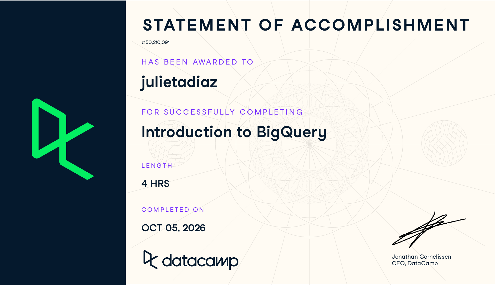

**Assignment:** SQL2: Introduction to BigQuery (DataCamp)\
**Course:** IBM 6500, Customer Insight Methods and Survey Research\
**Instructor:** Dr. Jae Jung\
**Program:** MSDM, Cal Poly Pomona

# Course-Completion Evidence

I completed the **Introduction to BigQuery** course through the IBM 6500 DataCamp classroom on **October 5, 2026**. DataCamp issued the Statement of Accomplishment below, which shows my name and the course title.

{fig-alt="DataCamp Statement of Accomplishment for the Introduction to BigQuery course, awarded to julietadiaz, completed October 5, 2026." width="92%" fig-align="center"}

# Learning Notes and Key Takeaways

The course is organized into four chapters. Chapter 1 explains what BigQuery is and how it is built, Chapter 2 covers writing queries, loading data, dates, and nested data, Chapter 3 covers CTEs, aggregations, and window functions, and Chapter 4 covers joins, data manipulation (DML), and query optimization.

Every exercise in the course uses an **e-commerce dataset** called `ecommerce`, which holds orders, payments, products, and sellers for an online store. I use the same tables in my examples below so the notes stay consistent. The most important tables are:

```{=html}
<div class="schema-grid" style="grid-template-columns: repeat(auto-fit, minmax(300px, 1fr));">
  <div class="schema-table">
    <div class="schema-name">ecomm_orders</div>
    <div class="schema-row key"><span>order_id</span><span>STRING</span></div>
    <div class="schema-row"><span>order_items</span><span>ARRAY&lt;STRUCT&gt;</span></div>
  </div>
  <div class="schema-table">
    <div class="schema-name">ecomm_order_details</div>
    <div class="schema-row key"><span>order_id</span><span>STRING</span></div>
    <div class="schema-row"><span>customer_id</span><span>STRING</span></div>
    <div class="schema-row"><span>order_status</span><span>STRING</span></div>
    <div class="schema-row"><span>order_purchase_timestamp</span><span>TIMESTAMP</span></div>
  </div>
  <div class="schema-table">
    <div class="schema-name">ecomm_payments</div>
    <div class="schema-row key"><span>order_id</span><span>STRING</span></div>
    <div class="schema-row"><span>payment_type</span><span>STRING</span></div>
    <div class="schema-row"><span>payment_installments</span><span>INT64</span></div>
    <div class="schema-row"><span>payment_value</span><span>FLOAT64</span></div>
  </div>
  <div class="schema-table">
    <div class="schema-name">ecomm_products</div>
    <div class="schema-row key"><span>product_id</span><span>STRING</span></div>
    <div class="schema-row"><span>product_category_name_english</span><span>STRING</span></div>
    <div class="schema-row"><span>product_weight_g</span><span>FLOAT64</span></div>
    <div class="schema-row"><span>product_photos_qty</span><span>INT64</span></div>
  </div>
</div>
```

::: {.schema-caption}
E-commerce course dataset (main fields only). Most tables share `order_id`. Each order's `order_items` field is an array of item records holding `product_id`, `seller_id`, and `price`.
:::

**About the names in my examples:** in BigQuery a table's full name has three parts, `project_name.dataset_name.table_name`. The **project** is the Google Cloud project that owns and pays for the work, the **dataset** is a folder that groups related tables, and the **table** holds the rows. The course environment already points at the right project, so most examples only need `dataset.table`, such as `ecommerce.ecomm_orders`. When I write `my_project`, `my_dataset`, or `my_table`, those are placeholders for whatever names a real project uses.

## Chapter 1: BigQuery Architecture and Structure

### Introduction to BigQuery

#### Main ideas {.unnumbered .unlisted}

- **BigQuery** is Google Cloud's fully managed, **serverless data warehouse**. "Serverless" means I never set up or maintain a server; I write SQL and Google provides the computing power behind the scenes.
- BigQuery is built for **analytics** (OLAP): large queries that scan, summarize, and compare millions or billions of rows. It is not designed to be the database behind an app that writes one row at a time.
- BigQuery uses its own dialect called **GoogleSQL**. Almost everything from Introduction to SQL (`SELECT`, `FROM`, `WHERE`, `GROUP BY`, `JOIN`) works the same way.
- **Storage and compute are separate.** Data sits in Google's storage layer, and compute power is added only while a query runs. Because of this, cost is based mostly on how much data is **stored** and how many bytes a query **scans**.
- Data is stored in a **columnar** format. A query only reads the columns it names, which is why choosing columns carefully makes queries faster and cheaper.

#### BigQuery terminology {.unnumbered .unlisted}

| Use BigQuery if... | Use another SQL database if... |
|:-------------------|:-------------------------------|
| You want separate storage and compute resources | You do not need distributed query workloads |
| You want to query large, semi-structured data | You want to run the service in any cloud provider |
| You are running large analytical queries | You need a transactional database (many small reads and writes) |

#### Example {.unnumbered .unlisted}

```sql
-- Preview the order details table
SELECT *
FROM ecommerce.ecomm_order_details
LIMIT 3;
```

#### Explanation of the example {.unnumbered .unlisted}

This query returns every column of the first three rows in `ecomm_order_details`. It is a quick way to see what a table looks like. One BigQuery-specific lesson: `LIMIT` reduces the rows **shown**, but on a normal table BigQuery still scans every column named in `SELECT`. On a real project I would use the table's **Preview** tab in the console instead, which is free.

::: {.callout-tip title="CEP application"}
Marketing data grows fast. Google Analytics 4 (GA4) can export raw website events straight into BigQuery, and ad platforms and e-commerce stores produce millions of rows. BigQuery lets me run analysis on that full data with plain SQL instead of downloading samples into spreadsheets, so a CEP client's whole history can be analyzed at once.
:::

### BigQuery Architecture

#### Main ideas {.unnumbered .unlisted}

BigQuery is made of several Google technologies that work together. The course groups them into three layers:

- **Storage:** **Colossus** is Google's distributed file system that physically stores the data. **Capacitor** is the columnar file format the data is saved in, which lets BigQuery read only the needed columns and compress them.
- **Query execution (Dremel):** **Dremel** is the engine that runs queries. It splits a query into an **execution tree**. **Mixers** at the top break the work up and combine the results, and **leaf nodes** at the bottom read data from storage. Each unit of computing power is called a **slot**.
- **Computing:** **Borg** is Google's cluster manager that assigns hardware to run the work, and **Jupiter** is the very fast network that moves data between storage and compute.

#### BigQuery terminology {.unnumbered .unlisted}

| Layer | Component | Role |
|:------|:----------|:-----|
| Storage | Colossus | Distributed file system that holds the data |
| Storage | Capacitor | Columnar storage format |
| Query execution | Dremel | Query engine that builds an execution tree |
| Query execution | Mixers and slots | Split, distribute, and combine query work |
| Query execution | Execution trees and leaf nodes | Leaf nodes read data and do the first calculations |
| Computing | Borg | Manages the machines that run the work |
| Computing | Jupiter | Network that connects storage and compute |

#### Example: how a query travels through the architecture {.unnumbered .unlisted}

1. I submit a query in the BigQuery console.
2. Dremel turns it into an execution tree; mixers divide the work across many slots.
3. Borg assigns machines, and Jupiter carries data from Colossus to the leaf nodes.
4. Leaf nodes read only the needed Capacitor columns, compute partial results, and pass them up to the mixers, which combine them into the final result.

#### Explanation of the example {.unnumbered .unlisted}

Because the work is split across thousands of slots running in parallel, a query that would take minutes on a single database server can finish in seconds. Knowing that BigQuery reads by column also explains why `SELECT *` is the most expensive habit to break.

::: {.callout-tip title="CEP application"}
I do not need to manage any of this myself, but understanding it helps me explain to a client why BigQuery costs depend on bytes scanned and why a well-written query is cheaper. That is useful when recommending BigQuery for a small business with a limited budget.
:::

### BigQuery Data Organization

#### Main ideas {.unnumbered .unlisted}

- Data is organized in a hierarchy: **Project > Dataset > Table**.
  - A **project** is the top-level container in Google Cloud. It controls billing, permissions, and which APIs are turned on.
  - A **dataset** groups related tables, like a folder. Access can be granted at the dataset level, and each dataset has a storage **location** (such as `US`).
  - A **table** holds the data in rows and columns, defined by a **schema**.
- A **schema** lists every column's name, **data type**, and **mode**. The mode can be `NULLABLE` (value may be missing), `REQUIRED` (value must exist), or `REPEATED` (the column holds an array).
- **Naming rules:** dataset names may use letters, numbers, and underscores only, and names are case sensitive. Table names may be longer and include some extra characters, but the safest habit is lowercase words joined by underscores.
- Besides standard tables, BigQuery has **views** (saved queries), **external tables** (data that stays in Cloud Storage or Google Sheets), and **partitioned** and **clustered** tables that are organized to make queries cheaper.

#### BigQuery terminology {.unnumbered .unlisted}

| Data type | Holds | Course example |
|:----------|:------|:---------------|
| `STRING` | Text | `order_id`, `order_status` |
| `INT64` | Whole numbers | `payment_installments` |
| `FLOAT64` / `NUMERIC` | Decimal numbers | `payment_value`, `price` |
| `BOOL` | `TRUE` / `FALSE` | Result of a logical test |
| `DATE`, `DATETIME`, `TIMESTAMP` | Dates and times | `order_purchase_timestamp` |
| `ARRAY` | A list of values | `order_items` |
| `STRUCT` | A record with named fields inside one column | Each item in `order_items` |

#### Example {.unnumbered .unlisted}

```sql
-- Fully qualified table name: project.dataset.table
SELECT DISTINCT seller_city
FROM `my_project.ecommerce.ecomm_sellers`;
```

#### Explanation of the example {.unnumbered .unlisted}

This query lists each seller city once. The table name has all three levels: `my_project` (placeholder for the Google Cloud project), `ecommerce` (the dataset), and `ecomm_sellers` (the table). Backticks are required around a full name when the project ID contains a hyphen, so using them every time is a good habit. Inside the course, `ecommerce.ecomm_sellers` was enough because the project was already set.

::: {.callout-tip title="CEP application"}
For a CEP client I would set up one project for the engagement and separate datasets by source, such as `ga4_raw`, `ads`, `shop_orders`, and `survey`. Dataset-level permissions let me share cleaned data with teammates while keeping raw customer data restricted.
:::

## Chapter 2: Writing Queries and Data Types

### Writing Queries in BigQuery

#### Main ideas {.unnumbered .unlisted}

- Writing queries in BigQuery uses the same core SQL from the first course, plus a review of `GROUP BY`, `ORDER BY`, and `JOIN`.
- Selecting only the needed columns is both cleaner and cheaper, since BigQuery bills by bytes scanned.
- Aggregate functions such as `SUM()` summarize many rows into one value per group. Every non-aggregated column in `SELECT` must also appear in `GROUP BY`.
- `JOIN ... USING (column)` is a short way to join two tables on a column that has the **same name** in both, such as `order_id`.

#### Important SQL syntax {.unnumbered .unlisted}

| Syntax | What it does |
|:-------|:-------------|
| `SELECT col1, col2` | Returns only the listed columns |
| `SUM(col)` | Adds up values in each group |
| `GROUP BY col` | Creates one result row per value of `col` |
| `ORDER BY col DESC` | Sorts from largest to smallest |
| `JOIN table USING (col)` | Joins on a shared column name |
| `LIMIT n` | Shows only the first `n` rows |

#### Example {.unnumbered .unlisted}

```sql
-- 1. Total payment value per order, smallest first
SELECT order_id, SUM(payment_value)
FROM ecommerce.ecomm_payments
GROUP BY order_id
ORDER BY SUM(payment_value)
LIMIT 10;

-- 2. Join orders to their details to show the most recent orders
SELECT
    ecomm_orders.order_id,
    ecomm_orders.order_items,
    ecomm_order_details.order_status,
    ecomm_order_details.order_purchase_timestamp
FROM ecommerce.ecomm_orders
JOIN ecommerce.ecomm_order_details USING (order_id)
ORDER BY order_purchase_timestamp DESC
LIMIT 10;
```

#### Explanation of the example {.unnumbered .unlisted}

The first query adds up every payment for each order, because one order can be paid in several parts, and lists the ten smallest totals. The second query combines the items in each order with that order's status and purchase time, then shows the ten newest orders. `USING (order_id)` works because both tables call the key `order_id`.

::: {.callout-tip title="CEP application"}
These two patterns answer the most common client questions: "What is the total value per order or customer?" and "What happened most recently?" Joining an orders table to a details table is also how I would connect a purchase to the marketing channel that produced it.
:::

### Data Ingestion in BigQuery

#### Main ideas {.unnumbered .unlisted}

- **Data ingestion** means loading data into BigQuery. Common ways are uploading a local file in the console, loading files from **Google Cloud Storage**, streaming rows in real time, or using the SQL `LOAD DATA` statement.
- **Accepted file formats:** CSV, JSON (newline-delimited), Avro, Parquet, and ORC. Google Sheets and Cloud Storage files can also be read as external tables. **XML is not supported** and must be converted first.
- `LOAD DATA INTO` creates or adds to a table. `LOAD DATA OVERWRITE` replaces the table's contents.
- When loading, BigQuery can **auto-detect** the schema, or I can define the column names and types myself, which is safer for messy files.

#### BigQuery procedure: uploading a local file in the console {.unnumbered .unlisted}

1. In the BigQuery console, open the **Explorer** panel and click the three dots next to a dataset.
2. Choose **Create table**, and set **Create table from** to **Upload**.
3. Select the file and its format (for example, CSV).
4. Name the destination table and choose **Auto detect** for the schema, or enter it by hand.
5. Click **Create table**, then check the **Schema** and **Preview** tabs.

#### Important SQL syntax {.unnumbered .unlisted}

```sql
-- Structure of a LOAD DATA statement
LOAD DATA INTO mydataset.table
FROM FILES(
  uris = ['gs://bucket/path/file.csv'],
  format = 'CSV');
```

#### Explanation of the example {.unnumbered .unlisted}

`LOAD DATA INTO` names the destination table (`mydataset` and `table` are placeholders). `FROM FILES(...)` points to the source. `uris` is a list of file paths in Cloud Storage (the `gs://` prefix means Google Cloud Storage; `bucket` is the storage bucket name and `path/file.csv` is the file inside it), and `format` tells BigQuery how to read the file. The order of the four lines matters: destination, source, location, then format.

::: {.callout-tip title="CEP application"}
Survey exports from Qualtrics, ad platform reports, and Shopify order exports usually come out as CSV files. Loading them into one BigQuery dataset lets me join survey answers to purchase data by a shared ID instead of copying and pasting between spreadsheets.
:::

### Date and Time Types in BigQuery

#### Main ideas {.unnumbered .unlisted}

- BigQuery has four date and time types:
  - `DATE`: a calendar date, such as `2017-11-24`.
  - `TIME`: a time of day with no date.
  - `DATETIME`: a date and time with **no time zone**.
  - `TIMESTAMP`: an exact moment in time, stored in **UTC**. The course data's `order_purchase_timestamp` is a `TIMESTAMP`.
- `EXTRACT(part FROM value)` pulls one piece out of a date or timestamp, such as `DATE`, `YEAR`, `QUARTER`, `MONTH`, `DAY`, or `HOUR`.
- `FORMAT_TIMESTAMP('%format', value)` turns a timestamp into readable text for reports. For example, `%D` gives `MM/DD/YY` and `%F` gives `YYYY-MM-DD`.
- `TIMESTAMP_ADD()` and `TIMESTAMP_SUB()` move a timestamp forward or backward by an `INTERVAL`, such as `INTERVAL 7 DAY`. Together with `BETWEEN`, they build date ranges.
- `DATE_DIFF(date1, date2, part)` returns the gap between two dates (date1 minus date2) in days, weeks, months, or years.
- `CURRENT_DATE()` and `CURRENT_TIMESTAMP()` return today's date and the current moment, which keeps reports up to date without hard-coding dates.

#### Important SQL syntax {.unnumbered .unlisted}

| Syntax | What it does |
|:-------|:-------------|
| `EXTRACT(MONTH FROM ts) = 9` | Keeps rows from September |
| `EXTRACT(DATE FROM ts) = '2016-09-15'` | Keeps rows from one exact day |
| `FORMAT_TIMESTAMP('%D', ts)` | Formats a timestamp as `MM/DD/YY` text |
| `TIMESTAMP_ADD(ts, INTERVAL 7 DAY)` | Adds 7 days |
| `TIMESTAMP_SUB(ts, INTERVAL 30 DAY)` | Subtracts 30 days |
| `DATE_DIFF(d1, d2, DAY)` | Number of days between two dates |
| `CURRENT_TIMESTAMP()` | The current date and time (UTC) |

#### Example {.unnumbered .unlisted}

```sql
-- 1. Orders in the fourth quarter of 2017
SELECT COUNT(order_id)
FROM ecommerce.ecomm_order_details
WHERE EXTRACT(QUARTER FROM order_purchase_timestamp) = 4
  AND EXTRACT(YEAR FROM order_purchase_timestamp) = 2017;

-- 2. Orders in the 3 days before and after Black Friday 2017
SELECT COUNT(order_id)
FROM ecommerce.ecomm_order_details
WHERE order_purchase_timestamp BETWEEN
    TIMESTAMP_SUB(TIMESTAMP('2017-11-24'), INTERVAL 3 DAY)
    AND TIMESTAMP_ADD(TIMESTAMP('2017-11-24'), INTERVAL 3 DAY);
```

#### Explanation of the example {.unnumbered .unlisted}

The first query counts orders placed from October through December 2017 by checking both the quarter and the year. The second builds a seven-day window around Black Friday (November 24, 2017): `TIMESTAMP('2017-11-24')` turns the text into a timestamp, `TIMESTAMP_SUB` finds the start, and `TIMESTAMP_ADD` finds the end. Comparing that count to a normal week would show how much the holiday lifted sales.

::: {.callout-tip title="CEP application"}
Date functions are the backbone of campaign reporting: sales during a promotion versus the weeks before it, month-over-month trends, or days between a customer's first and second purchase. For a resale shop, I could measure how many days items sit before they sell with `DATE_DIFF`.
:::

### Unstructured Data: Arrays, Structs, SEARCH, and UNNEST

#### Main ideas {.unnumbered .unlisted}

- BigQuery can store **nested and repeated** data, which is closer to how JSON looks than to a flat spreadsheet.
  - An **ARRAY** is a list of values of the same type in one cell.
  - A **STRUCT** is a record with named fields inside one cell, such as `price` and `product_id`.
  - An **ARRAY of STRUCTs** stores many records in one cell. In the course, each order's `order_items` is a list of item records.
- Nesting avoids extra tables and joins, so queries over large data run faster.
- `ARRAY(SELECT ...)` builds an array from a subquery's results.
- `SEARCH(column, 'text')` returns `TRUE` when the text appears anywhere in the column, even inside nested data.
- `UNNEST(array)` "flattens" an array so each element becomes its own row. After unnesting, **dot notation** (`items.price`) reads a field inside each struct.

#### Important SQL syntax {.unnumbered .unlisted}

| Syntax | What it does |
|:-------|:-------------|
| `ARRAY(SELECT col FROM ...)` | Builds an array from query results |
| `SEARCH(col, 'value')` | Checks whether a value appears in the column |
| `FROM table, UNNEST(array_col) AS alias` | Turns each array element into a row |
| `alias.field` | Reads one field from a struct |
| `ARRAY_LENGTH(array_col)` | Counts the elements in an array |

#### Example {.unnumbered .unlisted}

```sql
-- Show the price of every item in one order
SELECT
    order_id,
    items.price
FROM
    ecommerce.ecomm_orders,
    UNNEST(order_items) items
WHERE order_id = 'a0e747c954a595b0e3458c87ab1a4958';
```

#### Explanation of the example {.unnumbered .unlisted}

Before unnesting, this order is one row with all of its items packed into `order_items`. `UNNEST(order_items) items` turns each item into its own row and names it `items`, and `items.price` pulls the price field from each one. The comma between the table and `UNNEST` is a shorthand for a `CROSS JOIN`, which I covered again in Chapter 4.

::: {.callout-tip title="CEP application"}
The GA4 export to BigQuery stores each website event's details in a nested field called `event_params`, an array of key and value records. Knowing `UNNEST` and dot notation is required to pull out values such as page location or campaign source, so this lesson directly prepares me for GA4 analysis.
:::

## Chapter 3: Querying Data in BigQuery

### Common Table Expressions (CTEs)

#### Main ideas {.unnumbered .unlisted}

- A **common table expression** is a named, temporary result set created with `WITH name AS (...)`. The main query can then use it like a table.
- CTEs make long queries readable: each step gets a clear name instead of being buried in nested subqueries.
- Several CTEs can be chained with commas, and a later CTE can use an earlier one.
- CTEs help **optimization** by filtering and narrowing data early, so the main query works with fewer rows.

#### Important SQL syntax {.unnumbered .unlisted}

```sql
WITH first_step AS (
  SELECT ...
),
second_step AS (
  SELECT ... FROM first_step
)
SELECT ...
FROM second_step;
```

#### Example {.unnumbered .unlisted}

```sql
-- Count orders with an item over $150, grouped by order status
WITH orders AS (
  SELECT order_id
  FROM ecommerce.ecomm_orders, UNNEST(order_items) items
  WHERE items.price > 150
)
SELECT
  COUNT(order_id),
  order_status
FROM ecommerce.ecomm_order_details od
JOIN orders o USING (order_id)
GROUP BY order_status;
```

#### Explanation of the example {.unnumbered .unlisted}

The CTE named `orders` first finds every order that includes an item priced over $150. The main query joins that short list to the order details and counts how many of those higher-value orders are delivered, shipped, canceled, and so on. Splitting the logic into a CTE makes each step easy to read and test on its own.

::: {.callout-tip title="CEP application"}
CTEs let me build an analysis in clear stages, such as "customers who opened the email," then "those who purchased," then "their average order value." In a group project, teammates can read and check each step, which reduces mistakes.
:::

### Aggregations

#### Main ideas {.unnumbered .unlisted}

- **Aggregate functions** summarize many rows into one value. The course groups them into **statistical** functions (`COUNT`, `COUNTIF`, `SUM`, `AVG`) and **range** functions (`MIN`, `MAX`, `ANY_VALUE`).
- `COUNTIF(condition)` counts only the rows where the condition is true, which avoids a separate `WHERE` filter.
- `HAVING` filters **after** grouping, so it can filter on an aggregate such as an average. `WHERE` filters rows **before** grouping and cannot use aggregates.
- `ANY_VALUE(col)` returns any one value from the group. Adding `HAVING MAX` or `HAVING MIN` inside it returns the value from the row with the highest or lowest value of another column.

#### Important SQL syntax {.unnumbered .unlisted}

| Syntax | What it does |
|:-------|:-------------|
| `COUNTIF(col > 5000)` | Counts rows that meet a condition |
| `AVG(col)` | Average of a column |
| `GROUP BY col HAVING AVG(x) > 10000` | Keeps only groups that pass the test |
| `ANY_VALUE(col)` | Any single value from the group |
| `ANY_VALUE(a HAVING MAX b)` | The value of `a` from the row with the largest `b` |

#### Example {.unnumbered .unlisted}

```sql
-- Product categories whose average weight is over 10 kg
SELECT
    product_category_name_english,
    AVG(product_weight_g)
FROM ecommerce.ecomm_products
GROUP BY product_category_name_english
HAVING AVG(product_weight_g) > 10000;
```

#### Explanation of the example {.unnumbered .unlisted}

The query averages product weight inside each category and keeps only categories that average more than 10,000 grams. `HAVING` is required here because the filter uses the group's average, which does not exist until after `GROUP BY` runs.

::: {.callout-tip title="CEP application"}
`COUNTIF` and `HAVING` are ideal for segment questions, such as counting how many orders came from a discount code, or keeping only product categories with average order value above a target. These are the numbers that go straight into a client's dashboard.
:::

### Special Aggregations in BigQuery

#### Main ideas {.unnumbered .unlisted}

- **Logical aggregates:** `LOGICAL_AND(condition)` returns `TRUE` only if the condition is true for **every** row in the group. `LOGICAL_OR(condition)` returns `TRUE` if it is true for **at least one** row.
- **String and array aggregates:** `STRING_AGG(col, ', ')` joins text from many rows into one comma-separated string, and `DISTINCT` inside it removes repeats. `ARRAY_CONCAT_AGG(array_col)` merges arrays from many rows into one array.
- **Approximate aggregates** trade a tiny bit of accuracy for big speed and cost savings on huge tables:
  - `APPROX_COUNT_DISTINCT(col)`: estimated number of unique values.
  - `APPROX_TOP_COUNT(col, n)`: the `n` most frequent values and their counts.
  - `APPROX_TOP_SUM(col, weight, n)`: the `n` values with the largest total of `weight`.
  - `APPROX_QUANTILES(col, n)`: the values that split the data into `n` equal parts (for example, quartiles when `n` is 4).

#### Important SQL syntax {.unnumbered .unlisted}

| Function | Returns |
|:---------|:--------|
| `LOGICAL_AND(order_status = 'delivered')` | `TRUE` if all rows in the group were delivered |
| `LOGICAL_OR(order_status = 'shipped')` | `TRUE` if any row in the group shipped |
| `STRING_AGG(DISTINCT col, ', ')` | One text list of unique values |
| `ARRAY_CONCAT_AGG(order_items)` | One combined array |
| `APPROX_COUNT_DISTINCT(customer_id)` | Estimated unique customers |
| `APPROX_TOP_COUNT(customer_id, 3)` | Top 3 most frequent customers |
| `APPROX_QUANTILES(price, 4)` | Minimum, quartiles, and maximum price |

#### Example {.unnumbered .unlisted}

```sql
-- Estimated unique customers per order status
SELECT
    od.order_status,
    APPROX_COUNT_DISTINCT(od.customer_id) AS approx_customers
FROM ecommerce.ecomm_order_details od
GROUP BY od.order_status;
```

#### Explanation of the example {.unnumbered .unlisted}

For each order status, the query estimates how many different customers placed those orders. On a table with billions of rows, an exact `COUNT(DISTINCT ...)` has to track every unique ID, while the approximate version uses far less memory and usually lands within about one percent of the true count.

::: {.callout-tip title="CEP application"}
Unique users and unique customers are core marketing metrics. For large GA4 or ad data, `APPROX_COUNT_DISTINCT` gives a fast estimate for trend reporting, and `APPROX_QUANTILES` quickly shows the spread of order values, which helps set free-shipping thresholds or price tiers.
:::

### Window Functions

#### Main ideas {.unnumbered .unlisted}

- A **window function** calculates across a set of related rows but, unlike `GROUP BY`, keeps **every row** in the result.
- The parts of a window function, in order:
  1. The **function**, such as `RANK()` or `AVG()`.
  2. The **argument** inside it, such as `AVG(price)`.
  3. `OVER`, which starts the window.
  4. The **window specification**: `PARTITION BY` (separate groups) and `ORDER BY` (row order).
  5. The **window frame**, such as `ROWS BETWEEN`.
  6. The **range definition**, such as `2 PRECEDING AND CURRENT ROW`.
- `RANK()` numbers rows by an order, and ties share a rank.
- `LAG(col)` reads the value from the **previous** row and `LEAD(col)` reads the **next** row, which is useful for comparing each purchase to the one before or after it.
- **Row-based windows** (`ROWS BETWEEN n PRECEDING AND n FOLLOWING`) create rolling calculations, such as a rolling average.
- `QUALIFY` filters on the result of a window function, the same way `HAVING` filters on an aggregate. A regular `WHERE` cannot do this.

#### Important SQL syntax {.unnumbered .unlisted}

| Syntax | What it does |
|:-------|:-------------|
| `RANK() OVER(ORDER BY col DESC)` | Ranks rows from highest to lowest |
| `LAG(col) OVER(PARTITION BY id ORDER BY ts)` | Previous value for the same customer |
| `LEAD(col) OVER(PARTITION BY id ORDER BY ts)` | Next value for the same customer |
| `ROWS BETWEEN 9 PRECEDING AND CURRENT ROW` | Current row and the 9 rows before it |
| `ROWS BETWEEN CURRENT ROW AND 9 FOLLOWING` | Current row and the 9 rows after it |
| `QUALIFY rolling_avg > 500` | Filters on a window result |

#### Example {.unnumbered .unlisted}

```sql
-- Times when the 10-order rolling average item price was over $500
SELECT
  order_id,
  order_purchase_timestamp,
  AVG(item.price)
  OVER(ORDER BY order_purchase_timestamp
       ROWS BETWEEN 9 PRECEDING AND CURRENT ROW) AS rolling_avg
FROM ecommerce.ecomm_order_details od
JOIN ecommerce.ecomm_orders o
USING (order_id), UNNEST(o.order_items) AS item
QUALIFY rolling_avg > 500
ORDER BY order_purchase_timestamp;
```

#### Explanation of the example {.unnumbered .unlisted}

For every item sold, the query averages its price with the nine items sold just before it, in time order. That rolling average smooths out single big purchases. `QUALIFY` then keeps only the moments when the rolling average topped $500, which point to periods of unusually high-value sales.

::: {.callout-tip title="CEP application"}
Window functions answer customer-journey questions: `LAG` finds the days between a customer's purchases (repeat-purchase timing), `RANK` finds each customer's top products, and a rolling average smooths daily traffic or sales so a campaign's real effect is easier to see.
:::

## Chapter 4: Data Management and Optimization

### Joins in BigQuery

#### Main ideas {.unnumbered .unlisted}

- `INNER JOIN` (or just `JOIN`) keeps only rows that **match** in both tables.
- `LEFT JOIN` keeps **all rows from the left** table plus matches from the right; missing matches show as `NULL`.
- `RIGHT JOIN` keeps **all rows from the right** table plus matches from the left.
- `FULL OUTER JOIN` keeps **all rows from both** tables, matched or not.
- `CROSS JOIN` pairs every row of one table with every row of another. With `UNNEST`, it pairs each row with each element of its own array, which is how nested data is flattened. The comma in `FROM table, UNNEST(...)` is shorthand for this.
- Joins are often combined with aggregations: join a large fact table (orders) to a smaller lookup table (products), then group and count.

#### Important SQL syntax {.unnumbered .unlisted}

| Join | Keeps |
|:-----|:------|
| `INNER JOIN` | Only matching rows |
| `LEFT JOIN` | All left rows, plus matches |
| `RIGHT JOIN` | All right rows, plus matches |
| `FULL OUTER JOIN` | All rows from both tables |
| `CROSS JOIN UNNEST(array)` | Each row paired with each of its array elements |

#### Example {.unnumbered .unlisted}

```sql
-- Number of orders for each product
WITH orders AS (
  SELECT o.order_id, item.product_id
  FROM ecommerce.ecomm_orders o
  CROSS JOIN UNNEST(o.order_items) item
)
SELECT
    p.product_id,
    COUNT(o.order_id)
FROM orders o
JOIN ecommerce.ecomm_products p
USING (product_id)
GROUP BY p.product_id;
```

#### Explanation of the example {.unnumbered .unlisted}

The CTE uses `CROSS JOIN UNNEST` to turn each order's item list into one row per product purchased. The main query joins those rows to the products table on `product_id` and counts orders per product. Switching `JOIN` to `RIGHT JOIN` would also keep products that were never ordered (with a count of zero), which is useful for finding items that do not sell.

::: {.callout-tip title="CEP application"}
Choosing the right join changes the story the data tells. A `LEFT JOIN` from all customers to survey responses shows who did *not* respond, and a `FULL OUTER JOIN` between ad clicks and orders can reveal both clicks that never converted and sales with no tracked click.
:::

### Data Manipulation Language (DML) Statements

#### Main ideas {.unnumbered .unlisted}

- **DML** statements change the data inside tables instead of just reading it:
  - `INSERT` adds new rows.
  - `UPDATE` changes values in existing rows.
  - `DELETE` removes rows.
  - `MERGE` compares a source to a target and inserts, updates, or deletes in one step (an "upsert").
  - `CREATE TABLE AS SELECT` builds a brand new table from a query's results.
- `UPDATE` and `MERGE` modify existing data without creating tables, while `INSERT` adds rows to an existing table.
- **Conditions:** `UPDATE` and `DELETE` use `WHERE` (and can reference other tables with a join or subquery), and `MERGE` uses an `ON` join condition. In BigQuery, `UPDATE` and `DELETE` **require** a `WHERE` clause; to change every row I must write `WHERE TRUE`, which prevents accidents.
- **Performance considerations:** group many changes into one statement instead of running many single-row statements, and use **partitioned and clustered** tables so DML touches less data.

#### Important SQL syntax {.unnumbered .unlisted}

```sql
-- Add a row
INSERT INTO my_dataset.my_table (col1, col2)
VALUES ('a', 1);

-- Change existing rows (WHERE is required)
UPDATE my_dataset.my_table
SET col2 = 2
WHERE col1 = 'a';

-- Remove rows
DELETE FROM my_dataset.my_table
WHERE col2 = 0;

-- Build a new table from a query
CREATE TABLE my_dataset.new_table AS
SELECT col1, col2
FROM my_dataset.my_table;
```

#### Explanation of the example {.unnumbered .unlisted}

`my_dataset`, `my_table`, `new_table`, `col1`, and `col2` are placeholders. The `INSERT` adds one row, the `UPDATE` changes `col2` only where `col1` equals `'a'`, the `DELETE` removes rows where `col2` is zero, and `CREATE TABLE AS` saves a query result as a new table. Because DML permanently changes data, I would always run the matching `SELECT ... WHERE` first to see exactly which rows will be affected.

::: {.callout-tip title="CEP application"}
DML is how a cleaned, analysis-ready dataset gets built: `CREATE TABLE AS` to save a cleaned customer table, `UPDATE` to fix inconsistent category labels, and `MERGE` to add each week's new orders to a master table without duplicating old ones.
:::

### Query Optimization Strategies

#### Main ideas {.unnumbered .unlisted}

- In BigQuery, a faster query is usually a **cheaper** query, because cost depends on bytes scanned.
- **Select only the columns you need.** Avoid `SELECT *`, since every extra column is scanned and billed.
- **Filter early,** especially by date. On a table **partitioned** by date, a date filter lets BigQuery skip whole partitions. **Clustering** sorts data by chosen columns so filters on those columns read less.
- `LIMIT` does **not** lower the bytes scanned on a regular table; it only shortens the output.
- Use **approximate functions** (such as `APPROX_COUNT_DISTINCT`) when an exact answer is not required.
- Use **CTEs** to narrow data before joins, and join large tables to smaller ones.
- Check the **query validator** in the console before running; it shows how many bytes the query will process.

#### Important SQL syntax {.unnumbered .unlisted}

| Strategy | Example |
|:---------|:--------|
| Choose columns | `SELECT order_id, payment_type` instead of `SELECT *` |
| Filter by recent dates | `WHERE ts <= TIMESTAMP_SUB(CURRENT_TIMESTAMP(), INTERVAL 90 DAY)` |
| Estimate instead of count | `APPROX_COUNT_DISTINCT(order_id)` |
| Filter groups early | `WHERE payment_installments > 0` before `GROUP BY` |

#### Example {.unnumbered .unlisted}

```sql
-- Payment plans: customers per installment count and average installment value
SELECT
    p.payment_installments,
    APPROX_COUNT_DISTINCT(p.order_id),
    AVG(p.payment_value) / p.payment_installments AS avg_installment_value
FROM ecommerce.ecomm_payments p
JOIN ecommerce.ecomm_order_details o USING (order_id)
WHERE p.payment_installments > 0
GROUP BY p.payment_installments;
```

#### Explanation of the example {.unnumbered .unlisted}

This is the finance report built step by step in the final exercise. For each number of installments, it estimates how many orders used that payment plan and calculates the average amount paid per installment. It is optimized by reading only the columns it needs, filtering out orders with no installments before grouping, and using `APPROX_COUNT_DISTINCT` instead of an exact distinct count.

::: {.callout-tip title="CEP application"}
CEP budgets are small, so I need queries that do not waste money. Before running anything on a client's GA4 export, I would check the bytes estimate, select only needed fields, and filter to the campaign's date range. Those habits can be the difference between a free query and a surprise bill.
:::

## Quick Reference Cheat Sheet

| I want to... | BigQuery SQL |
|:-------------|:-------------|
| Refer to a table fully | `` `project.dataset.table` `` |
| Load a file from Cloud Storage | `LOAD DATA INTO ds.t FROM FILES(uris=['gs://...'], format='CSV');` |
| Pull a date part | `EXTRACT(MONTH FROM ts)` |
| Format a timestamp | `FORMAT_TIMESTAMP('%F', ts)` |
| Last 30 days | `ts >= TIMESTAMP_SUB(CURRENT_TIMESTAMP(), INTERVAL 30 DAY)` |
| Days between dates | `DATE_DIFF(d1, d2, DAY)` |
| Flatten an array | `FROM t, UNNEST(arr) AS a` |
| Read a struct field | `a.field_name` |
| Name a step | `WITH step AS (SELECT ...)` |
| Count with a condition | `COUNTIF(condition)` |
| Filter groups | `HAVING AVG(col) > n` |
| Estimate unique values | `APPROX_COUNT_DISTINCT(col)` |
| Rank rows | `RANK() OVER(ORDER BY col DESC)` |
| Previous / next row | `LAG(col) OVER(...)` / `LEAD(col) OVER(...)` |
| Rolling average | `AVG(col) OVER(ORDER BY ts ROWS BETWEEN 9 PRECEDING AND CURRENT ROW)` |
| Filter on a window result | `QUALIFY window_alias > n` |
| Keep all rows from both tables | `FULL OUTER JOIN` |
| Save a query as a table | `CREATE TABLE ds.t AS SELECT ...` |

# Overall Reflection and Future Reference

**What were the most useful BigQuery concepts or procedures I learned?**
The most useful ideas were the project, dataset, and table hierarchy, the date functions (`EXTRACT`, `TIMESTAMP_SUB`, `CURRENT_TIMESTAMP`), and `UNNEST` for nested data. Window functions with `QUALIFY` were also powerful, because they answer "compared to the previous purchase" and "rolling average" questions that are hard to do in a spreadsheet.

**How is using BigQuery different from learning SQL syntax alone?**
Learning SQL taught me how to ask for data. BigQuery added the questions of **where the data lives and what a query costs**. Because BigQuery stores data by column and bills by bytes scanned, how I write a query has a direct price. BigQuery also handles nested arrays and structs, loading files from Cloud Storage, and data at a scale that a regular database or spreadsheet cannot.

**Which concepts or procedures were most challenging?**
Nested data took the most practice. I had to remember that `UNNEST` creates one row per array element and that I then use dot notation such as `items.price`. Window function syntax was also tricky because the parts must go in the right order, and small mistakes like a stray comma in `ROWS BETWEEN 9 PRECEDING` or an extra parenthesis cause errors. Matching each DML statement to the conditions it allows needed careful review too.

**How could BigQuery support digital marketing analytics, customer insights, survey research, GA4 analysis, or my CEP?**
BigQuery is where marketing data from many sources can come together. GA4 exports raw events to BigQuery, so I can use `UNNEST` on `event_params` to build custom reports that the GA4 interface does not offer. Survey results from Qualtrics and order exports from an online store can be loaded as CSV files and joined to customer records by ID. Window functions can measure repeat purchase timing, date functions can compare campaign periods, and approximate functions keep large queries fast and affordable for a CEP client.

**What steps, terms, or query patterns do I expect to review again?**
I expect to review the `LOAD DATA` structure, the list of date-format codes for `FORMAT_TIMESTAMP`, the order of parts in a window function, and the difference between `HAVING` and `QUALIFY`. I will also keep the optimization checklist (choose columns, filter dates, check bytes, use approximations) in mind for any real project, and build on these skills in the upcoming **Intermediate SQL** course.

# Appendix: Publication Links {.unnumbered}

- [GitHub Repository](https://github.com/jukedz/ibm-6500-sql-learning-portfolio)
- [Published Introduction to BigQuery Report](https://jukedz.github.io/ibm-6500-sql-learning-portfolio/introduction-to-bigquery.html)
