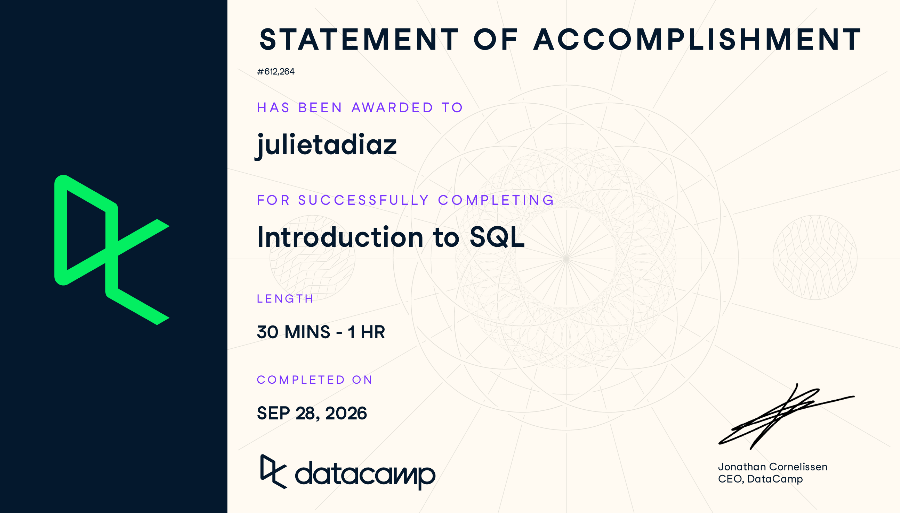

**Assignment:** SQL1: Introduction to SQL (DataCamp)\
**Course:** IBM 6500, Customer Insight Methods and Survey Research\
**Instructor:** Dr. Jae Jung\
**Program:** MSDM, Cal Poly Pomona

# Course-Completion Evidence

I completed the **Introduction to SQL** course through the IBM 6500 DataCamp classroom on **September 28, 2026**. DataCamp issued the Statement of Accomplishment below, which shows my name and the course title.

{fig-alt="DataCamp Statement of Accomplishment for the Introduction to SQL course, awarded to julietadiaz, completed September 28, 2026." width="92%" fig-align="center"}

# Learning Notes and Key Takeaways

The course is organized into two chapters. Chapter 1 explains how relational databases store data, and Chapter 2 teaches how to write queries to retrieve that data. Most examples in the course use a small library database with three tables: `books`, `patrons`, and `checkouts`. I use the same database in my examples below so the notes stay consistent.

## Chapter 1: Relational Databases

### Databases

#### Main ideas {.unnumbered .unlisted}

- A **database** is an organized collection of data stored on a computer. A **relational database** stores data in multiple tables that are connected (related) to each other through shared fields.
- **SQL** (Structured Query Language, often pronounced "sequel") is the language used to create, manage, and ask questions of relational databases.
- Databases beat spreadsheets once data grows: they hold far more data, keep it more secure (access can be controlled), and let many people query the same data at the same time without overwriting each other.
- In the library example, one table holds books, one holds patrons (library members), and one holds checkouts. The `checkouts` table links a patron to a book, which is what makes the database *relational*.

#### Important SQL syntax {.unnumbered .unlisted}

| Term | Meaning |
|:-----|:--------|
| Database | A collection of related tables |
| Relational database | Tables connected by shared fields such as IDs |
| SQL | The language used to work with relational databases |
| Query | A request for data written in SQL |

#### Example {.unnumbered .unlisted}

```sql
-- Look at everything stored in the books table
SELECT *
FROM books;
```

#### Explanation of the example {.unnumbered .unlisted}

This query asks the database to return every column (`*`) and every row from the `books` table. It is the quickest way to preview what a table contains before writing more specific queries.

::: {.callout-tip title="CEP application"}
A CEP client's data (customers, orders, products, campaign results) usually lives in a relational database rather than one giant spreadsheet. Understanding that data is split across related tables helps me ask the client for the right tables and understand how customers connect to their purchases.
:::

### Tables

#### Main ideas {.unnumbered .unlisted}

- A table is made of **rows** and **columns**. A row is called a **record** (one book, one patron, one checkout). A column is called a **field** (one attribute, such as `title` or `author`).
- Every record in a table should describe the same kind of thing, and each table should focus on one subject.
- **Naming conventions:** table names should be lowercase, use underscores instead of spaces, and be plural (`books`, `patrons`). Field names should be lowercase, singular, use underscores, and should not repeat the table name.
- **Unique identifiers (keys):** each record should have a field whose value is unique for that record, such as `card_num` for patrons or `id` for books. Keys are what allow tables to be linked.
- It is better to have several focused tables that are linked than one huge table that repeats the same information many times.

#### Important SQL syntax {.unnumbered .unlisted}

| Concept | Example | Notes |
|:--------|:--------|:------|
| Record (row) | One patron | Horizontal line of data |
| Field (column) | `member_year` | Vertical attribute shared by every record |
| Unique identifier / key | `card_num` | One value per record, never repeated |
| Table name | `patrons` | Lowercase, plural, underscores |

#### Example {.unnumbered .unlisted}

```sql
-- Return each patron's card number and name
SELECT card_num, name
FROM patrons;
```

#### Explanation of the example {.unnumbered .unlisted}

This query returns two fields from the `patrons` table. `card_num` is the unique identifier, so each row in the result represents exactly one patron. The same `card_num` also appears in the `checkouts` table, which is how the two tables are related.

::: {.callout-tip title="CEP application"}
When I build or receive a customer dataset, I should confirm that each customer has a unique ID (like a customer number or email). That key is what lets me connect survey responses, purchases, and campaign clicks back to the same customer without double counting.
:::

### Data

#### Main ideas {.unnumbered .unlisted}

- Every field has a **data type** that tells the database what kind of values the field can hold. Using the right type saves storage space and allows the right operations (you can do math on numbers but not on text).
- Common data types from the course:
  - `VARCHAR`: strings of text of varying length, such as names or titles.
  - `INT`: whole numbers, such as a year.
  - `NUMERIC`: numbers with decimals, such as a fine amount.
- A **database schema** is a blueprint of the database. It shows the tables, the fields in each table, their data types, and how the tables relate.
- Data is physically stored on a **database server**, a computer (often in the cloud) that stores the data and answers queries from many users.

#### Important SQL syntax {.unnumbered .unlisted}

| Data type | Holds | Library example |
|:----------|:------|:----------------|
| `VARCHAR` | Text / strings | `title`, `author`, `name` |
| `INT` | Whole numbers | `year`, `member_year` |
| `NUMERIC` | Decimal numbers | `total_fine` |
| `DATE` | Calendar dates | `start_date`, `due_date` |

The library schema can be pictured like this:

```{=html}
<div class="schema-grid">
  <div class="schema-table">
    <div class="schema-name">books</div>
    <div class="schema-row key"><span>id</span><span>INT</span></div>
    <div class="schema-row"><span>title</span><span>VARCHAR</span></div>
    <div class="schema-row"><span>author</span><span>VARCHAR</span></div>
    <div class="schema-row"><span>year</span><span>INT</span></div>
    <div class="schema-row"><span>genre</span><span>VARCHAR</span></div>
  </div>
  <div class="schema-table">
    <div class="schema-name">checkouts</div>
    <div class="schema-row key"><span>id</span><span>INT</span></div>
    <div class="schema-row"><span>start_date</span><span>DATE</span></div>
    <div class="schema-row"><span>due_date</span><span>DATE</span></div>
    <div class="schema-row"><span>card_num</span><span>VARCHAR</span></div>
    <div class="schema-row"><span>book_id</span><span>INT</span></div>
  </div>
  <div class="schema-table">
    <div class="schema-name">patrons</div>
    <div class="schema-row key"><span>card_num</span><span>VARCHAR</span></div>
    <div class="schema-row"><span>name</span><span>VARCHAR</span></div>
    <div class="schema-row"><span>member_year</span><span>INT</span></div>
    <div class="schema-row"><span>total_fine</span><span>NUMERIC</span></div>
  </div>
</div>
<p class="schema-caption">Library database schema. <code>checkouts</code> links to <code>patrons</code> through <code>card_num</code> and to <code>books</code> through <code>book_id</code>.</p>
```

#### Example {.unnumbered .unlisted}

The course focuses on reading schemas rather than creating tables, but writing one out as SQL helps me remember how data types are assigned:

```sql
-- How the patrons table's schema would be written in SQL
CREATE TABLE patrons (
    card_num    VARCHAR(10),
    name        VARCHAR(50),
    member_year INT,
    total_fine  NUMERIC(5, 2)
);
```

#### Explanation of the example {.unnumbered .unlisted}

This statement defines a `patrons` table with four fields. `card_num` and `name` are text (`VARCHAR`) with a maximum length, `member_year` is a whole number (`INT`), and `total_fine` is a decimal number (`NUMERIC(5, 2)` means up to 5 digits, 2 of them after the decimal point, such as `125.50`).

::: {.callout-tip title="CEP application"}
Data types matter when I clean marketing data. For example, if order totals are stored as text instead of `NUMERIC`, I cannot sum revenue correctly. Reading the schema first helps me catch problems like ZIP codes stored as numbers (which drops leading zeros) before I start an analysis.
:::

## Chapter 2: Querying

### Introducing Queries

#### Main ideas {.unnumbered .unlisted}

- A **query** is a request for data from a database. The result of a query is a **result set**, which looks like a table but is not saved in the database.
- Every basic query uses two **keywords**:
  - `SELECT` names the fields (columns) I want.
  - `FROM` names the table the fields come from.
- I can select one field, several fields separated by commas, or all fields with the asterisk `*`.
- SQL keywords are not case sensitive, but the convention is to write keywords in **UPPERCASE** and table and field names in lowercase. This makes queries easier to read.
- A query ends with a semicolon `;`, which tells the database the statement is finished.

#### Important SQL syntax {.unnumbered .unlisted}

| Syntax | What it does |
|:-------|:-------------|
| `SELECT field` | Chooses which field(s) to return |
| `FROM table` | Names the table to pull data from |
| `SELECT field1, field2` | Returns several fields, in the order listed |
| `SELECT *` | Returns every field in the table |
| `;` | Ends the query |

#### Example {.unnumbered .unlisted}

```sql
-- Get the title, author, and year of every book
SELECT title, author, year
FROM books;
```

#### Explanation of the example {.unnumbered .unlisted}

The query returns three fields from the `books` table, in the order they are listed after `SELECT` (title first, then author, then year). All rows are returned because there is no filter. Choosing only the fields I need keeps results readable and runs faster than `SELECT *` on large tables.

::: {.callout-tip title="CEP application"}
For a customer insights project, I could pull just the fields I need, such as `customer_id`, `signup_date`, and `channel`, instead of downloading an entire customer table. That keeps the export small and avoids pulling personal information I do not need.
:::

### Writing Queries

#### Main ideas {.unnumbered .unlisted}

- **Aliasing** with `AS` renames a field in the result set only. It does not change the name in the database. Aliases make output clearer, for example renaming `name` to `first_name`.
- `DISTINCT` removes duplicate values so each value appears only once. When used with more than one field, it returns each unique *combination* of those fields.
- A **view** is a saved query. `CREATE VIEW view_name AS` stores the query so I can reuse it later by selecting from the view as if it were a table. A view does not store its own copy of the data; it re-runs the query each time, so it always reflects the current data.

#### Important SQL syntax {.unnumbered .unlisted}

| Syntax | What it does |
|:-------|:-------------|
| `SELECT field AS new_name` | Renames a field in the result set |
| `SELECT DISTINCT field` | Returns only unique values |
| `SELECT DISTINCT field1, field2` | Returns unique combinations of values |
| `CREATE VIEW view_name AS` | Saves a query as a reusable virtual table |
| `SELECT * FROM view_name` | Queries a saved view |

#### Example {.unnumbered .unlisted}

```sql
-- 1. Rename a field with an alias
SELECT name AS first_name, member_year
FROM patrons;

-- 2. List each author only once
SELECT DISTINCT author
FROM books;

-- 3. Save a query as a view, then use it
CREATE VIEW library_authors AS
SELECT DISTINCT author AS unique_author
FROM books;

SELECT *
FROM library_authors;
```

#### Explanation of the example {.unnumbered .unlisted}

1. The first query returns patron names under the new column heading `first_name`, plus the year each patron joined.
2. The second query returns a list of authors with no repeats, even if an author wrote several books in the library.
3. The third block saves the unique-author query as a view called `library_authors`. After that, a simple `SELECT * FROM library_authors;` returns the same list without rewriting the original query.

::: {.callout-tip title="CEP application"}
`DISTINCT` is useful for questions like "Which product categories did customers buy?" or "Which channels brought in traffic?" Views are helpful in a group project: a teammate could save a cleaned "active customers" query as a view, and everyone on the team would query the same definition instead of rebuilding it.
:::

### SQL Flavors

#### Main ideas {.unnumbered .unlisted}

- SQL has several **flavors** (dialects). They share the same core keywords, so most basic queries work everywhere, but some syntax differs.
- **PostgreSQL** is free and open source. It is the flavor used in the course.
- **SQL Server** is Microsoft's database system and uses a flavor called **T-SQL**.
- A key example of a difference: limiting how many rows are returned. PostgreSQL uses `LIMIT` at the end of the query, while SQL Server uses `TOP` right after `SELECT`.
- Employers and clients usually choose one flavor, so it is important to check which one a project uses. Google BigQuery (the next course in this portfolio) uses its own flavor, GoogleSQL.

#### Important SQL syntax {.unnumbered .unlisted}

| Task | PostgreSQL | SQL Server (T-SQL) |
|:-----|:-----------|:-------------------|
| Return only the first 2 rows | `SELECT ... FROM ... LIMIT 2;` | `SELECT TOP(2) ... FROM ...;` |
| Cost | Free, open source | Commercial (Microsoft) |

#### Example {.unnumbered .unlisted}

```sql
-- PostgreSQL: preview the first 2 books
SELECT id, title
FROM books
LIMIT 2;

-- SQL Server: the same request in T-SQL
SELECT TOP(2) id, title
FROM books;
```

#### Explanation of the example {.unnumbered .unlisted}

Both queries return only the first two rows of `id` and `title` from `books`. The goal is identical, but PostgreSQL places `LIMIT 2` at the end, while SQL Server places `TOP(2)` immediately after `SELECT`. Running the wrong version in the wrong system will produce an error.

::: {.callout-tip title="CEP application"}
Before querying a client's data, I should find out which database system they use. Previewing a large table with `LIMIT` (or `TOP`) lets me check what the data looks like without pulling millions of rows, which is faster and less likely to crash a notebook or spreadsheet.
:::

## Quick Reference Cheat Sheet

| I want to... | SQL |
|:-------------|:----|
| See everything in a table | `SELECT * FROM table;` |
| Get specific columns | `SELECT col1, col2 FROM table;` |
| Rename a column in the results | `SELECT col AS new_name FROM table;` |
| Remove duplicate values | `SELECT DISTINCT col FROM table;` |
| Save a query to reuse | `CREATE VIEW view_name AS SELECT ...;` |
| Preview a few rows (PostgreSQL) | `SELECT * FROM table LIMIT 5;` |
| Preview a few rows (SQL Server) | `SELECT TOP(5) * FROM table;` |

# Overall Reflection and Future Reference

**What were the most useful skills I learned?**
The most useful skill was learning to read a database as a set of related tables and then write `SELECT ... FROM` queries to pull exactly the fields I need. Aliasing and `DISTINCT` were also immediately practical, because they turn raw output into clean, readable lists I could drop into a report or a chart.

**Which SQL concepts were most challenging?**
Views took the most thought, because a view looks like a table but does not actually store data; it re-runs its query every time. The differences between SQL flavors were also tricky, since a query that works in PostgreSQL (`LIMIT`) fails in SQL Server (`TOP`). I need to remember to check the flavor first.

**How could SQL support digital marketing analytics, customer insights, survey research, or my CEP?**
Marketing and customer data (web traffic, email campaign results, orders, survey responses) is usually stored in databases, not spreadsheets. SQL lets me pull only the fields I need, find the unique segments, channels, or product categories in the data, and save reusable queries as views so my team works from the same definitions. For survey research, SQL could join survey responses to customer records using a shared ID. For a retail business, including a small resale shop, SQL could answer questions such as which product categories sell most or which channels bring in repeat customers.

**What concepts or commands do I expect to review again?**
I expect to come back to the data types table (especially `VARCHAR` versus `NUMERIC`), the syntax for `CREATE VIEW`, and the `LIMIT` versus `TOP` difference. I will also build on these basics in the upcoming **Intermediate SQL** course (filtering, aggregating, and grouping) and the **Introduction to BigQuery** course.

# Appendix: Publication Links {.unnumbered}

- [GitHub Repository](https://github.com/jukedz/ibm-6500-sql-learning-portfolio)
- [Published Introduction to SQL Report](https://jukedz.github.io/ibm-6500-sql-learning-portfolio/introduction-to-sql.html)
